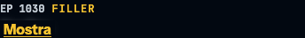
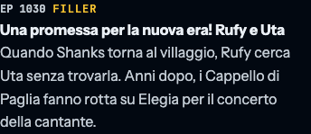
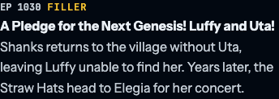

# Episode 1030 summary editorial review (#739)

Reviewed **2026-10-22**, against repository baseline `34f505f`. This maintainer
document contains plot information. It is not loaded by the application or used
as a public credit page.

These are generated screenshots of the project UI at 390 px, not source images.
The episode 1030 row stays covered at bookmark 1029 and opens at 1030:

| Italian, bookmark 1029                                               | Italian, bookmark 1030                                              | English, bookmark 1030                                              |
| -------------------------------------------------------------------- | ------------------------------------------------------------------- | ------------------------------------------------------------------- |
|  |  |  |

## Decision

Replace only `summary.en` and `summary.it` for episode 1030 in
`src/data/filler.ts`. The owner selected a replacement from independently
checked facts rather than retaining the uncertain wording under a source
license. The new summaries use two event facts from the official episode
synopsis, not a paraphrase of the wiki passage identified by #719.

The checked source is the Japanese text of
[ONE PIECE.com's episode 1030 page](https://one-piece.com/anime/o6217/index.html).
It confirms Shanks' return without Uta and, in the present-day section, the
crew's journey to her concert on Elegia. These are the only facts selected for
the replacement. Each locale expresses them briefly; neither translates the
official synopsis as a whole or retains its dialogue and descriptive wording.
The earlier dream, crying and destruction details are omitted.

This is a check of the official written synopsis, **not a claim to have watched
the episode**. No screenshots, subtitles, transcripts or video were downloaded.
The source is evidence for the events, not an open-content permission grant. The
replacement is not assigned MIT or a blanket CC license. This review does not
retroactively clear the old text or certify the rest of the archive.

## Source evidence and comparison

Both wiki source responses were retrieved through their revision-pinned API URLs
in [sources.json](content-provenance/sources.json), with revision IDs and
content SHA-256 checked against that manifest:

| Source                                                                           | Checked material                                                                                                                                                                                                                                                                    |
| -------------------------------------------------------------------------------- | ----------------------------------------------------------------------------------------------------------------------------------------------------------------------------------------------------------------------------------------------------------------------------------- |
| [English revision 2124761](https://onepiece.fandom.com/index.php?oldid=2124761)  | Read the Short Summary and full Long Summary in context. The old local English summary compresses several passages; its distinctive ten-word overlap is in the childhood-dream passage. The return, reaction and destruction details also appear later in the source.               |
| [Italian revision 345562](https://onepiece.fandom.com/it/index.php?oldid=345562) | Read the full Riassunto. Its dream passage differs from the English one, while the old local Italian summary closely follows the local English sentence. Translation direction and historical inputs remain unknown; a low Italian exact-match count cannot establish independence. |
| [Official episode page](https://one-piece.com/anime/o6217/index.html)            | Japanese synopsis, episode number and broadcast date (2022-08-21), accessed 2026-10-22 through Firecrawl after ordinary browser retrieval returned 403. Firecrawl scrape ID: `01a1645d-fe32-75e8-b6e6-3374ab91172f`. No open reuse license was established.                         |

The retrieved official-page Markdown has SHA-256
`ce1f2995b538f077d908fd630d3994f010856eaf7ef0b553dea06fb881eca048`. This
identifies that retrieval, not a permanent revision of the live page. The full
response is kept only in ignored local evidence at
`.gate/739/.firecrawl/official-1030.md`; it is not committed. Future retrievals
may differ. The two revision-verified wiki API responses are cached under
`.gate/provenance/` as described by the original audit.

Using the existing normalizer in [reproduce.py](content-provenance/reproduce.py)
and `SequenceMatcher` with `autojunk=False`, compare each locale's summary
against its full pinned wiki wikitext, without title fields:

| Locale  | Before: words / longest contiguous match | After: words / longest contiguous match |
| ------- | ---------------------------------------- | --------------------------------------- |
| English | 31 / 10                                  | 24 / 3                                  |
| Italian | 33 / 3                                   | 25 / 3                                  |

The new longest runs are generic location phrasing in English and the crew's
name in Italian. These counts are a limited similarity check, **not a rights
test**. The editorial basis is the separate official fact check and new, brief
selection of events, not just the reduction in matching words. The original
audit already expanded the adjacent sample to episode 1029 and Film Red; this
review identified no further distinctive overlap requiring another expansion. It
does not clear the other entries.

## Reproduction and verification

1. Read the local baseline with `git show 34f505f:src/data/filler.ts`, and
   compare episode 1030 with the two pinned wiki revisions above. The exact API
   URLs and expected content hashes remain in
   `docs/content-provenance/sources.json`.
2. Read the official page's two synopsis paragraphs. Check the two selected
   facts without substituting an episode watch or a wiki paraphrase for this
   stated method.
3. For the word-run comparison, use `words()` from the existing audit utility on
   the summary and revision content, then
   `difflib.SequenceMatcher(None, local_words, source_words, autojunk=False).find_longest_match().size`.
   Baseline and new summaries are the only inputs that change. The original
   `comparisons.json` remains evidence for #719's historical baseline; running
   the full original reproducer on the replacement will correctly report drift.
4. Verify that reverting just the two summary strings makes `src/data/filler.ts`
   byte-identical to the baseline. Episode/chapter gates, kinds, titles, dates
   and every other entry must stay unchanged. Compare base/head `archive:table`
   output and `--dated-only` output separately, retaining order and duplicates.
5. Run `npm run verify:filler` and `npm run check`. The filler verifier checks
   classifications, titles and mappings, not these summaries' wording; its wiki
   cache does not expire. Do not interpret a passing run as a fresh
   content-rights audit.

The historical findings in the [#719 audit](content-provenance-audit.md) and the
bilingual [license scope](../LICENSE-SCOPE.md) now link this disposition. Public
attribution infrastructure remains #721, historical quotations were reviewed in
#738, and future contributions follow the sources and rights rules from #725 in
[CONTRIBUTING.md](../CONTRIBUTING.md#sources-and-rights). Neither the
application's spoiler boundary nor those separate scopes change here.
